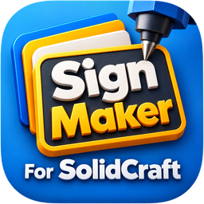
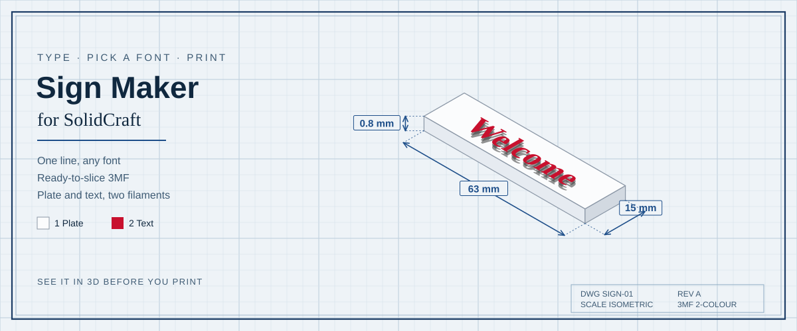
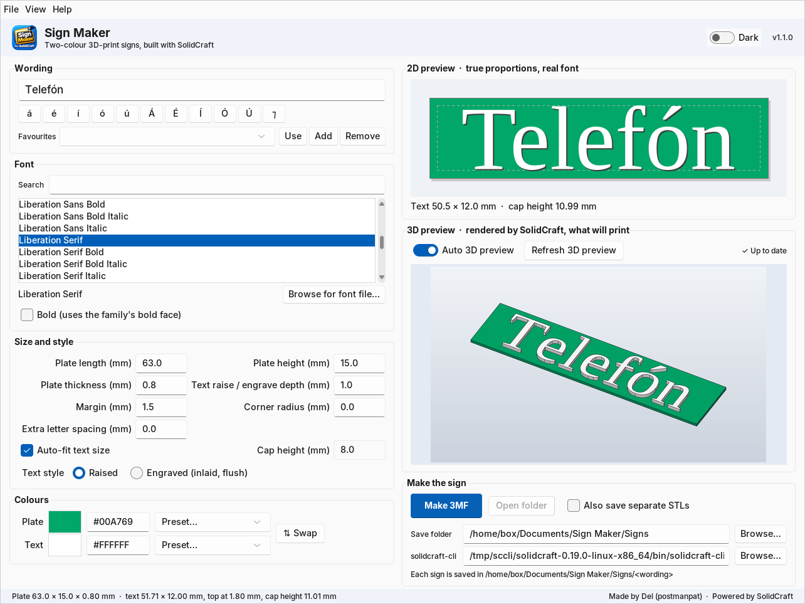
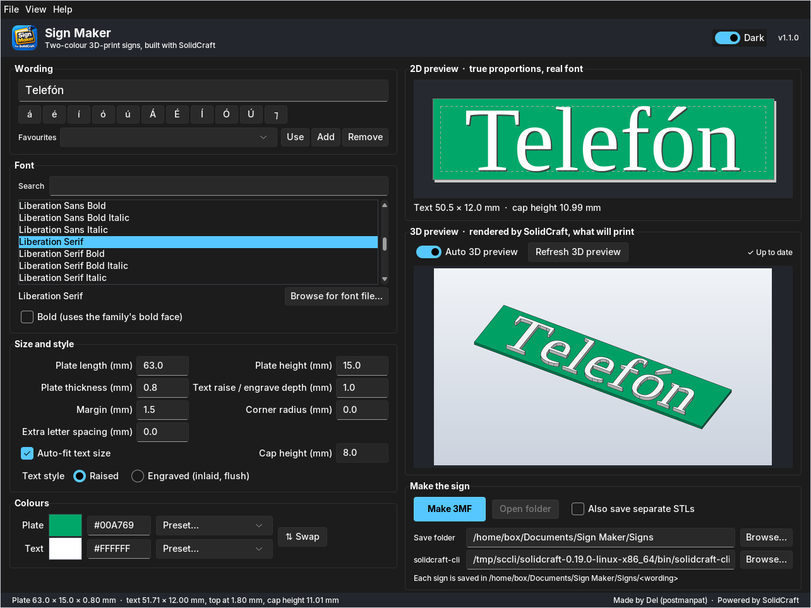
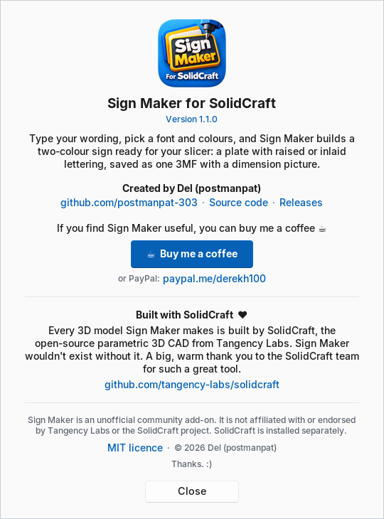
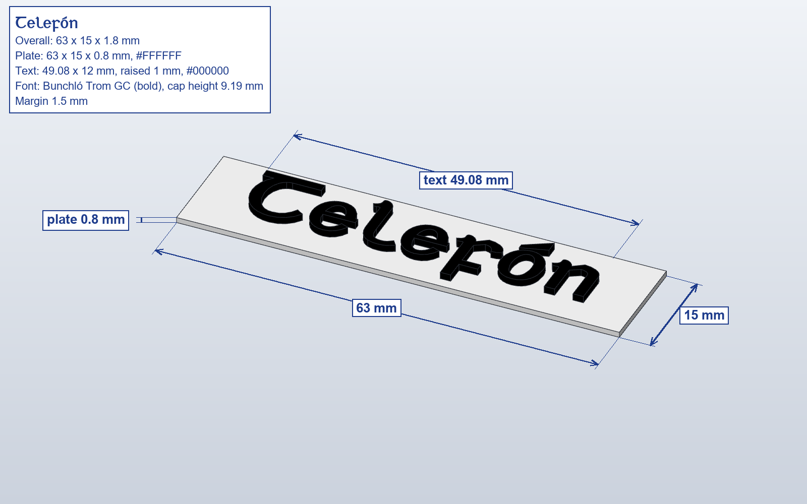
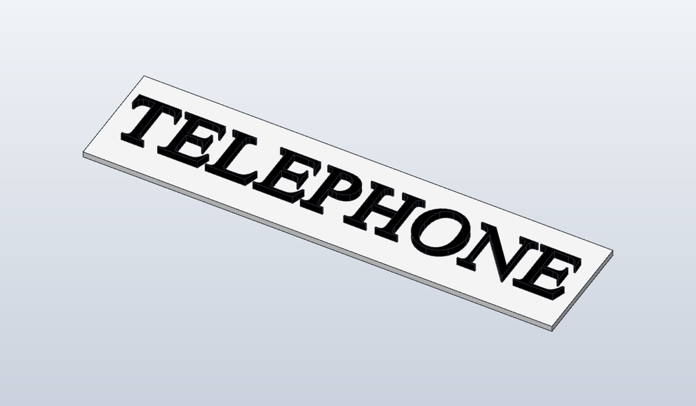

<p align="center">
  
</p>

<p align="center">
  <picture>
    <source media="(prefers-color-scheme: dark)" srcset="docs/banner-dark.svg">
    
  </picture>
</p>

<p align="center"><sub>The drawing above is an illustration. The window below is a real screenshot.</sub></p>

<p align="center">
  
  
  
  
  <a href="https://github.com/tangency-labs/solidcraft"></a>
  
  
</p>

<p align="center">
  <strong>Type a line of text, pick a font, and export a two-colour sign that drops into your slicer.</strong>
</p>

<p align="center">
  Unofficial community add-on for <a href="https://github.com/tangency-labs/solidcraft">SolidCraft</a>.
  Not affiliated with or endorsed by the SolidCraft maintainers.
</p>

Sign Maker builds a small 3D-print nameplate: a plate with one line of text centred on it. You see the sign in 2D immediately, and in 3D a moment later: the 3D preview rebuilds itself in the background about a second after you stop typing or changing anything. **Make 3MF** writes one file with two parts, Plate on filament 1 and Text on filament 2, plus a dimension picture and the `.solidcraft` design.

It stays a SolidCraft companion. The 3D preview and the mesh come from SolidCraft's headless `solidcraft-cli`. The 2D preview does not need it.

## What it does

| | |
|---|---|
| ✍️ **Wording** | One line, with buttons for á é í ó ú and the Tironian et ⁊ |
| 🔤 **Any font** | Installed fonts, or a `.ttf` / `.otf` / `.ttc` you browse to. Bold uses the family's bold face |
| 📐 **Sizes** | Plate, thickness, raise, margin, corner radius, letter spacing. Text auto-fits, or you set the cap height |
| 🎨 **Two colours** | Plate and text. Swatches, `#RRGGBB`, or presets |
| 👁️ **2D preview** | True proportions, drawn with the real font file |
| 🧊 **Live 3D preview** | SolidCraft's own render of the sign that will print. Updates by itself about a second after your last change, in the background so the window never freezes. Turn **Auto 3D preview** off and use **Refresh 3D preview** (F5) instead if you prefer |
| 🧵 **3MF** | One object, two parts. Plate = filament 1, Text = filament 2 |
| ⭐ **Favourites** | Wording, font and colours, remembered with the rest of the settings |
| 🌗 **Light and dark** | A clean, modern Windows 11 style look ([Sun Valley](https://github.com/rdbende/Sun-Valley-ttk-theme)) in light or dark: the **Dark** switch or **View** menu |
| ☰ **Menus** | **File** (Make 3MF, save folder, SolidCraft path), **View** (auto 3D preview, theme) and **Help** (About, GitHub, check for new releases) |

## Screenshots

<p align="center">
  
  <br>
  <sub>The main window: wording “Telefón”, white on An Post green. The 3D preview is SolidCraft's render, refreshed automatically.</sub>
</p>

<table>
  <tr>
    <td align="center" width="50%">
      
      <br>
      <sub>Dark theme.</sub>
    </td>
    <td align="center" width="50%">
      
      <br>
      <sub>Help › About.</sub>
    </td>
  </tr>
  <tr>
    <td align="center" width="50%">
      
      <br>
      <sub>Dimension sheet for a Telefón sign, saved beside the 3MF.</sub>
    </td>
    <td align="center" width="50%">
      
      <br>
      <sub>3D preview of “TELEPHONE” in Times New Roman, rendered by SolidCraft.</sub>
    </td>
  </tr>
</table>

**Make 3MF** also saves a dimension picture (`<Wording> - dimensions.png`). The sheet and the render above are a dimensioned “Telefón” and a raised “TELEPHONE”.

## Quick start

1. Install [Python 3.10 or newer](https://www.python.org/downloads/) and [SolidCraft](https://github.com/tangency-labs/solidcraft/releases) (see [SolidCraft and its CLI](#solidcraft-and-its-cli) below).
2. Install the Python libraries (Pillow, fontTools and the Sun Valley theme):

   ```bash
   python -m pip install -r requirements.txt
   ```

3. Start the app.

   | | |
   |---|---|
   | Windows | Double-click `run.bat`, or `pythonw SignMaker.pyw` |
   | macOS | Double-click `run.command` (or `./run.sh` in Terminal) |
   | Linux | `./run.sh` |

   On Linux, Tk is often a separate package: `sudo apt install python3-tk`.

4. If Sign Maker cannot see `solidcraft-cli`, press **Browse** and point at it. You can still edit the wording and use the 2D preview before that.
5. Change anything and the 3D preview follows on its own. Press **Make 3MF** to save.

Finished signs go in `~/Documents/Sign Maker/Signs/<Wording>/`. Change that folder in the window. An existing sign is never overwritten: the next one is `<Wording>_v2`, `_v3`, …

## Default sign

| | |
|---|---|
| Plate | 63 × 15 × 0.8 mm |
| Text | centred, raised 1.0 mm |
| Overall height | 1.8 mm |
| Margin | 1.5 mm |
| Corner radius | 0 (set one if you want rounded corners) |
| Colours | plate `#FFFFFF` on filament 1, text `#000000` on filament 2 |
| Sample wording | Telefón |

Engraved style cuts the letters into the plate and leaves a flush inlay of the text colour. It is still two parts.

## Downloads

Standalone bundles are attached to a GitHub Release when a tag `v*` is pushed. They are not published by this README on its own. Until a release exists, use the source launchers above.

[Releases](https://github.com/postmanpat-303/SignMaker-for-SolidCraft/releases)

### Windows installer

The easiest way on Windows is the Setup exe: download `SignMaker-<version>-setup-x64.exe` from the [latest release](https://github.com/postmanpat-303/SignMaker-for-SolidCraft/releases/latest) and run it.

- Installs to `C:\Program Files\Sign Maker` (asks for admin rights), with a **Start Menu** shortcut, an optional **desktop** shortcut, and an uninstaller in **Settings > Apps**.
- Shows the MIT licence, and reminds you that SolidCraft is installed separately.
- Running a newer setup upgrades in place. Your settings and saved signs are kept, and uninstalling leaves them alone too.
- Silent install: `SignMaker-<version>-setup-x64.exe /S`
- The setup is not code-signed. If SmartScreen says "Windows protected your PC", choose **More info** then **Run anyway**.

Prefer no install? The portable zip below runs from any folder.

| | Windows | macOS | Linux |
|---|---|---|---|
| File | `SignMaker-<version>-setup-x64.exe` (installer) or `SignMaker-windows-x64.zip` (portable) | `SignMaker-macos-arm64.zip` | `SignMaker-linux-x86_64.tar.gz` |
| Run | Run the setup, or unzip and open `SignMaker.exe` (leave `_internal` beside it). | Unzip and open `Sign Maker.app`. | `tar -xzf SignMaker-linux-x86_64.tar.gz` then `./SignMaker/SignMaker` |
| Notes | x64. The author tests here. | **New, community-tested.** Apple silicon (arm64), not a universal2 binary. Unsigned: the first time, right-click the app and choose **Open**. Intel Macs: use `run.command`. | **New, community-tested.** x86_64, built on Ubuntu. The tarball includes `icon.png` and `sign-maker.desktop`. aarch64: use `run.sh`. |

macOS and Linux builds are new. Sign Maker was written and tested on Windows, and those two ports are community-tested from there.

## SolidCraft and its CLI

Sign Maker drives `solidcraft-cli` (tested with SolidCraft 0.18.3 on Windows and 0.19.0 on Linux). Get it from the [SolidCraft releases](https://github.com/tangency-labs/solidcraft/releases). Headless use is described in the [SolidCraft print docs](https://docs.solidcraft.io/print.html).

| OS | Where the CLI comes from |
|---|---|
| Windows | The **MSI** (usually `C:\Program Files\SolidCraft\solidcraft-cli.exe`) or the **portable zip** (`solidcraft-cli.exe` next to `solidcraft.exe`). The single-file `.exe` does not include the CLI. |
| macOS | The separate `solidcraft-cli-…-macos-universal.zip`, or `SolidCraft.app/Contents/MacOS/solidcraft-cli` if your build has it there. |
| Linux | The `.deb`, `.rpm` or `.tar.gz` (`solidcraft-cli` on `PATH`, under `/usr/bin`, `/usr/local/bin`, `~/.local/bin` or `/opt`). An AppImage is the desktop app; extract it (`--appimage-extract`) if you need the CLI inside `squashfs-root`. |

Sign Maker looks next to the app, on `PATH`, and in those places. If it still cannot find the file, use **Browse**. The path is saved in the settings file.

## Fonts

Any installed font works, and **Browse for font file…** adds a `.ttf`, `.otf` or `.ttc`. Font files are not bundled with Sign Maker.

## What gets saved

Inside `~/Documents/Sign Maker/Signs/<Wording>/` (or the folder you chose):

| File | What it is |
|---|---|
| `<Wording>.3mf` | One object, parts **Plate** (filament 1) and **Text** (filament 2) |
| `<Wording>.solidcraft` | The design, so you can open it in SolidCraft |
| `<Wording> - dimensions.png` | The sign with measurements |
| `<Wording> - plate.stl` and `<Wording> - text.stl` | Only if **Also save separate STLs** is ticked |

Designer metadata inside the 3MF is `Del (postmanpat)`.

<details>
<summary><strong>Slicer tips</strong></summary>

The 3MF is one object with two parts, already sitting in the right place, so the text lands on the plate.

In **Bambu Studio**, **OrcaSlicer** and **Anycubic Slicer Next**:

1. Open the `.3mf`.
2. Assign **filament 1** to the Plate part and **filament 2** to the Text part.
3. Slice. You should not have to move the text onto the plate.

The same layout was checked in OrcaSlicer and Bambu Studio. Anycubic Slicer Next is the same family of slicer.

</details>

<details>
<summary><strong>Troubleshooting</strong></summary>

**solidcraft-cli was not found.** Install a SolidCraft package that includes the CLI (not the Windows single-file `.exe`), then Browse. The 2D preview still works without it.

**3D preview or Make 3MF fails.** The 3D pane says so and the status bar shows SolidCraft's message. A character the font cannot draw, or a script face whose letters overlap, is the usual cause.

**The 3D preview is slow on my PC.** Each preview is a full SolidCraft build (a few seconds). Untick **Auto 3D preview** and press **Refresh 3D preview** (F5) when you want one.

**No fonts in the list.** On Linux install a font package and `fontconfig` (`fc-list` should print paths). On macOS the system font folders are scanned. You can always browse to a font file.

**Linux: the window does not open.** Install Tk: `sudo apt install python3-tk` (Debian, Ubuntu, Mint).

**macOS: the app is damaged or cannot be opened.** It is unsigned. Right-click `Sign Maker.app` and choose **Open** the first time.

**The text is bigger than the plate.** The 2D line under the preview says so. Raise the plate size, lower the cap height, or leave auto-fit on.

**A glyph is missing.** The preview names the character. Pick a font that includes the needed letters (for example the fada vowels).

</details>

## From the command line

```bash
python signcore.py "Telefón" --font "Times New Roman"
python SignMaker.pyw --selftest
```

`--selftest` does not open a window you have to click. It writes a log next to the settings and prints `SELFTEST OK` when the checks it can run have finished. It does not need SolidCraft; a missing CLI is reported and the rest still runs.

Settings:

| OS | Folder |
|---|---|
| Windows | `%APPDATA%\SignMaker\settings.json` |
| macOS | `~/Library/Application Support/SignMaker/settings.json` |
| Linux | `~/.config/SignMaker/settings.json` (`$XDG_CONFIG_HOME` if you set it) |

## Limits

- One line of text.
- Joined-up script fonts, and `.ttc` collections, are only lightly tested. Overlapping letters may not extrude cleanly.
- A character the font does not contain is flagged under the 2D preview.

## Building a release bundle

Tag `v*` (for example `v1.0.0`) and push the tag. GitHub Actions runs PyInstaller on Windows, macOS and Linux and attaches the Windows setup exe and zip, the macOS app zip and the Linux tarball, plus `SHA256SUMS.txt`, to the release. The Windows setup is built with [NSIS](https://nsis.sourceforge.io/) from `packaging/windows/signmaker.nsi`; `tools/make_branding.py` draws its wizard bitmaps. The macOS runner's Python is arm64-only, so that build is not universal2. Do not expect a published release until a tag is pushed.

Icons for the bundles come from `assets/`. `tools/make_icons.py` rebuilds the `.ico`, `.icns` and 256 px PNG from `assets/icon.png`.

## Licence and credit

MIT. Copyright 2026 **Del (postmanpat)**. See [LICENSE](LICENSE).

Sign Maker is an unofficial community add-on. It is not affiliated with or endorsed by the [SolidCraft](https://github.com/tangency-labs/solidcraft) maintainers.

Thank you to [SolidCraft](https://github.com/tangency-labs/solidcraft) by Tangency Labs (Apache-2.0): every 3D model Sign Maker makes is built by it, and Sign Maker wouldn't exist without it. The look comes from the [Sun Valley ttk theme](https://github.com/rdbende/Sun-Valley-ttk-theme) by rdbende (MIT), bundled in the downloads.

## Support the author

If you find Sign Maker useful, you can buy me a coffee ☕

[Buy Me a Coffee](https://buymeacoffee.com/postmanpat) · [PayPal](https://paypal.me/derekh100)
